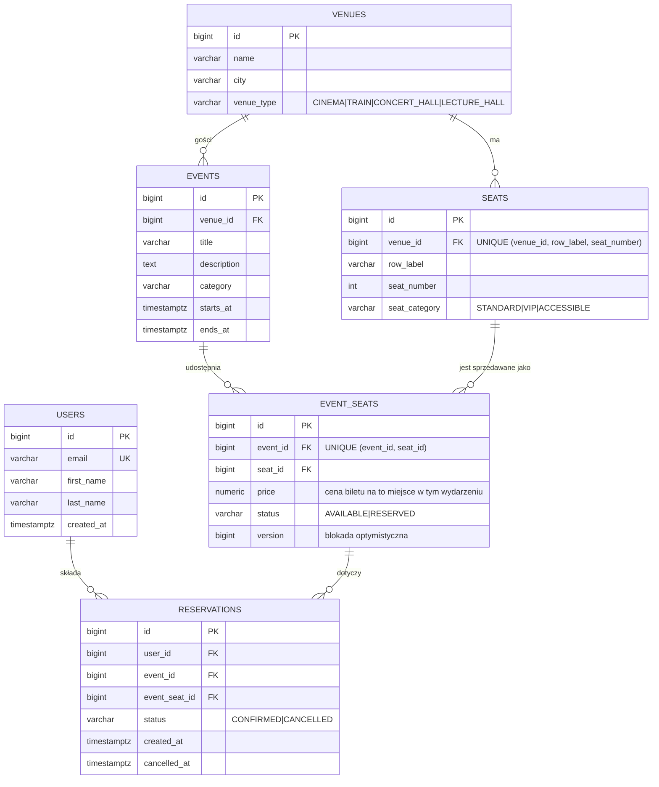

# Schemat bazy danych (PostgreSQL)



## Tabele

| Tabela | Rola |
|---|---|
| `users` | Użytkownicy (generowani Fakerem). |
| `venues` | Sale / obiekty: kino, wagon pociągu, sala koncertowa, sala wykładowa. |
| `seats` | Fizyczne miejsca w sali. Unikalne `(venue_id, row_label, seat_number)`. |
| `events` | Wydarzenia odbywające się w danej sali. |
| `event_seats` | Miejsce wystawione na konkretne wydarzenie (cena, status, `version`). **To jest zasób, o który rywalizują transakcje.** |
| `reservations` | Rezerwacja jednego miejsca przez jednego użytkownika. |


Jedna rezerwacja = jedno miejsce. Żądanie z kilkoma miejscami tworzy kilka wierszy w jednej transakcji (wszystko albo nic).

Strategia współbieżności **nie jest zapisywana w bazie** — ani przy rezerwacji, ani przy wydarzeniu. To ustawienie
backendu (`app.reservation.locking-strategy` w `application.properties`), więc wszyscy użytkownicy w danym
uruchomieniu idą tą samą ścieżką. Żeby porównać strategie, odpalamy test kilka razy z różnym ustawieniem.

## Mapowanie na testowane mechanizmy

| # | Mechanizm | Jak w tym schemacie |
|---|---|---|
| 1 | Blokada pesymistyczna | `SELECT … FROM event_seats WHERE id = ? FOR UPDATE`, potem `UPDATE status = 'RESERVED'` + `INSERT INTO reservations`. Pozostałe transakcje czekają na zwolnienie blokady. |
| 2 | Blokada optymistyczna | `UPDATE event_seats SET status = 'RESERVED', version = version + 1 WHERE id = ? AND version = ?` — 0 zmienionych wierszy oznacza przegraną, klient ponawia próbę. |
| 3 | Poziomy izolacji | Ta sama logika „sprawdź status → wstaw rezerwację” uruchamiana pod `READ COMMITTED`, `REPEATABLE READ`, `SERIALIZABLE`; obserwujemy anomalie (np. podwójna rezerwacja, błędy serializacji). |
| 4 | Ograniczenie UNIQUE | `CREATE UNIQUE INDEX ux_reservation_active ON reservations (event_id, event_seat_id) WHERE status = 'CONFIRMED';` — baza sama odrzuca drugą aktywną rezerwację; anulowane nie blokują miejsca. |

## Szkic DDL (do kroku 1 planu prac)

```sql
CREATE TABLE users (
    id          BIGSERIAL PRIMARY KEY,
    email       VARCHAR(255) NOT NULL UNIQUE,
    first_name  VARCHAR(100) NOT NULL,
    last_name   VARCHAR(100) NOT NULL,
    created_at  TIMESTAMPTZ  NOT NULL DEFAULT now()
);

CREATE TABLE venues (
    id          BIGSERIAL PRIMARY KEY,
    name        VARCHAR(255) NOT NULL,
    city        VARCHAR(100) NOT NULL,
    venue_type  VARCHAR(20)  NOT NULL CHECK (venue_type IN ('CINEMA', 'TRAIN', 'CONCERT_HALL', 'LECTURE_HALL'))
);

CREATE TABLE seats (
    id             BIGSERIAL PRIMARY KEY,
    venue_id       BIGINT      NOT NULL REFERENCES venues (id),
    row_label      VARCHAR(10) NOT NULL,
    seat_number    INT         NOT NULL CHECK (seat_number > 0),
    seat_category  VARCHAR(20) NOT NULL DEFAULT 'STANDARD' CHECK (seat_category IN ('STANDARD', 'VIP', 'ACCESSIBLE')),
    UNIQUE (venue_id, row_label, seat_number)
);

CREATE TABLE events (
    id           BIGSERIAL PRIMARY KEY,
    venue_id     BIGINT       NOT NULL REFERENCES venues (id),
    title        VARCHAR(255) NOT NULL,
    description  TEXT,
    category     VARCHAR(20)  NOT NULL,
    starts_at    TIMESTAMPTZ  NOT NULL,
    ends_at      TIMESTAMPTZ  NOT NULL,
    CHECK (ends_at > starts_at)
);

CREATE TABLE event_seats (
    id        BIGSERIAL PRIMARY KEY,
    event_id  BIGINT        NOT NULL REFERENCES events (id),
    seat_id   BIGINT        NOT NULL REFERENCES seats (id),
    price     NUMERIC(10,2) NOT NULL CHECK (price >= 0),
    status    VARCHAR(20)   NOT NULL DEFAULT 'AVAILABLE' CHECK (status IN ('AVAILABLE', 'RESERVED')),
    version   BIGINT        NOT NULL DEFAULT 0,
    UNIQUE (event_id, seat_id)
);

CREATE TABLE reservations (
    id                BIGSERIAL PRIMARY KEY,
    user_id           BIGINT      NOT NULL REFERENCES users (id),
    event_id          BIGINT      NOT NULL REFERENCES events (id),
    event_seat_id     BIGINT      NOT NULL REFERENCES event_seats (id),
    status            VARCHAR(20) NOT NULL DEFAULT 'CONFIRMED' CHECK (status IN ('CONFIRMED', 'CANCELLED')),
    created_at        TIMESTAMPTZ NOT NULL DEFAULT now(),
    cancelled_at      TIMESTAMPTZ
);

CREATE UNIQUE INDEX ux_reservation_active
    ON reservations (event_id, event_seat_id)
    WHERE status = 'CONFIRMED';

CREATE INDEX ix_reservations_user ON reservations (user_id);
CREATE INDEX ix_event_seats_event ON event_seats (event_id);
```
